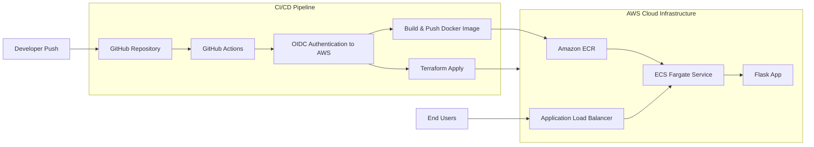

# CI/CD Project - Automated app deployment on AWS

A small Flask app packaged with Docker and deployed to AWS. The project demonstrates an end-to-end delivery flow from source code to a running service, with infrastructure provisioned using Terraform and delivery automated in GitHub Actions.

## What this shows

- Containerized Flask app served by Gunicorn
- Infrastructure provisioned with Terraform
- VPC with public and private subnets, NAT gateways, and an internet-facing ALB
- ECS Fargate service running in private subnets
- ECR repository with image scanning and lifecycle policy
- CloudWatch Logs for ECS task logs
- GitHub Actions workflows for infrastructure and application deployment
- OIDC-based auth from GitHub Actions to AWS
- Variable-driven scaling and sizing for infra and ECS tasks
- S3 remote state with lockfile-based locking

## Architecture




### Architecture details

#### VPC & networking

- The infra provisions a single VPC across 2 Availability Zones with public and private subnets. Public subnets host the internet-facing Application Load Balancer (ALB) and NAT gateways; private subnets host ECS Fargate tasks so containers are not directly reachable from the internet.
- The ALB (deployed in public subnets) routes HTTP traffic to an ECS target group with health checks on `/healthz`. Security groups restrict inbound HTTP to the ALB and only allow the ALB to reach ECS tasks.
- Containers run as Fargate tasks with task definitions referencing images stored in Amazon ECR. Images are built by GitHub Actions, scanned, and subject to a lifecycle policy to limit storage. Logs from tasks go to CloudWatch Log Groups; ALB access logs can optionally be written to S3.
- Route tables, Internet Gateway (IGW), and NAT gateways provide required routing and outbound access for private resources.

#### Bootstrap & Terraform state

- The `infra/bootstrap` module provisions the S3 backend for Terraform state and creates native S3 lockfile-based locking to enable safe concurrent runs from CI.
- The bootstrap module also creates an IAM role trusted by GitHub Actions via OIDC; workflows assume this role to run Terraform and to push/pull images from ECR. This OIDC-based flow avoids storing long‑lived AWS access keys in GitHub by issuing short‑lived credentials to workflows when they assume the role.
- ECS task execution and task roles are created with least-privilege policies for ECR, CloudWatch Logs, and any AWS APIs the container needs.


## Repo layout

- `src/` - Flask app (`/` and `/healthz`)
- `Dockerfile` - image build for Gunicorn + Flask
- `infra/bootstrap/` - bootstrap state bucket and OIDC role
- `infra/app/` - VPC, ALB, ECS, ECR, and logging
- `.github/workflows/` - CI/CD pipelines

## GitHub Actions workflows

- `infra.yaml` - runs Terraform fmt/validate/plan/apply on `infra/app` changes
- `deploy.yaml` - builds and pushes the Docker image to ECR repository, then updates ECS service
- `destroy.yaml` - destroys `infra/app` resources on manual trigger


## Setup and usage

### ⚠️ Warning — AWS charges: 
Running the Terraform configuration and deploying ECS/Fargate, ALB, ECR storage, NAT gateways, and other resources WILL incur AWS charges. Destroy resources when not in use and monitor billing in the AWS console.

### Prerequisites

- An AWS account with permissions to create necessary resources
- `Terraform` configured with the aforementioned AWS account
- A GitHub repository with access to set repository `Secrets` and `Variables` (see below)
- (Local testing) `Docker` (for local builds), and optionally the `aws` CLI for troubleshooting.


### 1) Bootstrap the infrastructure (one time)

Note: Before running the bootstrap part, make sure that the GitHub OIDC provider is added to your IAM
and that you provide values for `github_repo` / `github_org` e.g in a `.auto.tfvars` file.  

The bootstrap module creates the S3 state bucket and the GitHub Actions OIDC role.

```bash
cd infra/bootstrap
terraform init
terraform apply
```

Capture the output `github_actions_role_arn` for GitHub Actions secrets.

### 2) Configure GitHub Actions

Set these in the GitHub repo:

**Secrets**
- `AWS_ROLE_ARN` - output from the bootstrap step

**Variables**
- `AWS_REGION` - e.g. `eu-west-1`
- `ECR_REPOSITORY` - e.g. `cicd-demo-app`
- `ECS_CLUSTER` - e.g. `cicd-demo-cluster`
- `ECS_SERVICE` - e.g. `cicd-demo-service`
- `ECS_TASK_FAMILY` - e.g. `cicd-demo-task`
- `ECS_CONTAINER_NAME` - e.g. `cicd-demo-container`

These values match defaults in `infra/app`.

### 3) Provision infrastructure

Push to `main` with changes under `infra/app/` to trigger the Terraform workflow, use manual dispatch, or run Terraform locally:

```bash
cd infra/app
terraform init
terraform apply
```

### 4) Deploy the app

Push to `main` with changes under `src/` to trigger the build and deploy workflow (or use manual dispatch).

## Local run (optional)

You can test the app locally with `docker`:

```bash
docker build -t cicd-demo .
docker run -p 5000:5000 cicd-demo
```

Then visit `http://localhost:5000/` or `http://localhost:5000/healthz`.

## Destroy

Run the `destroy.yaml` workflow (manual trigger), or locally:

```bash
cd infra/app
terraform destroy
```

Note: ECR repositories must be empty before destroy. If images remain, delete them or update the ECR resource to use `force_delete = true`.
